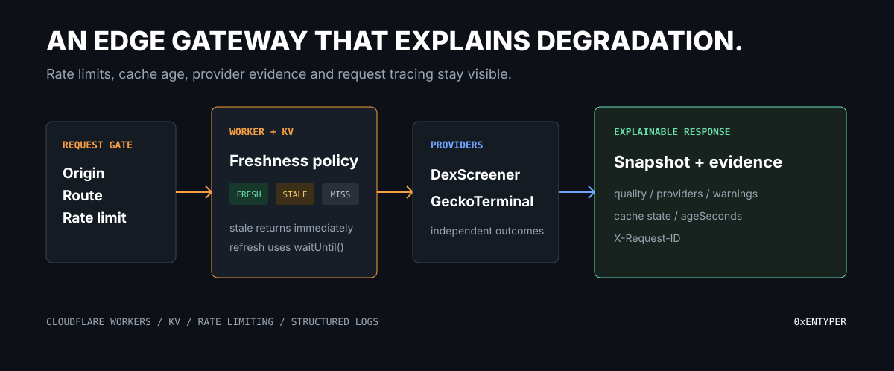
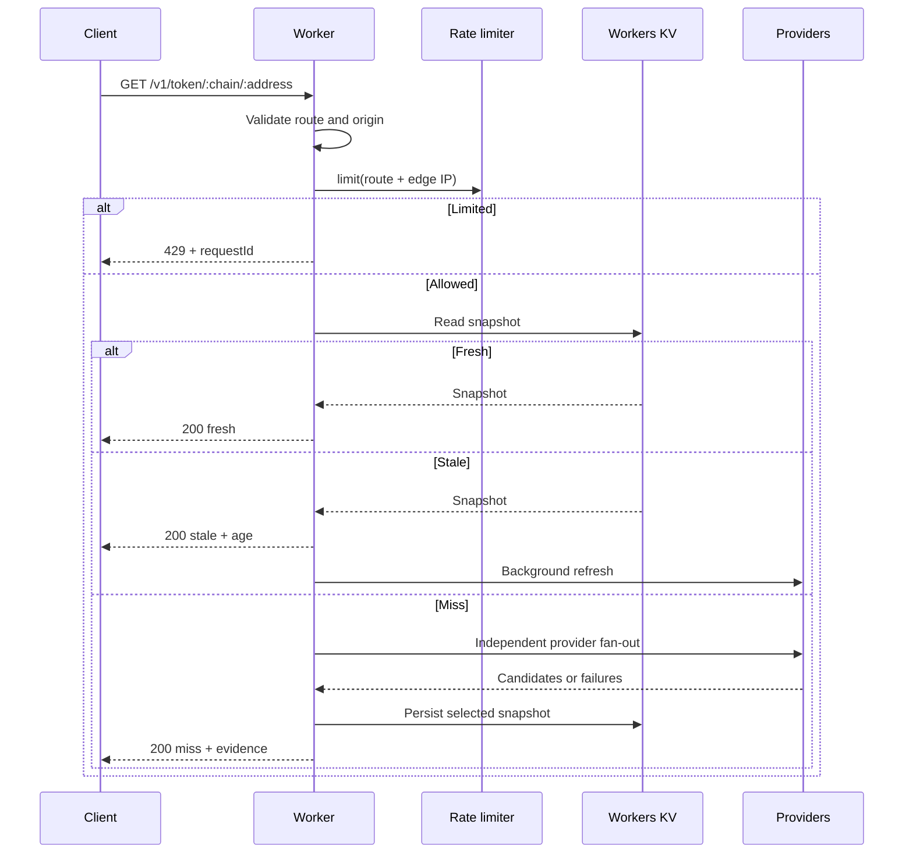

<div align="center">

# Cloudflare Web3 API Gateway

### A runnable edge gateway for rate-limited, cached, traceable multi-provider token data.

    [](https://github.com/0xENTYPER/cloudflare-web3-api-gateway/actions/workflows/ci.yml)

</div>



Public onchain APIs are useful but unreliable product dependencies. This reference Worker puts a stable boundary in front of them: validated routes, explicit CORS, native rate limiting, KV freshness states, independent provider failures, typed capitalization, structured logs, and request IDs.

It is a runnable public reference, not a production gateway or a dump of private provider configuration.

## What it demonstrates

| Boundary | Implementation | Product effect |
| --- | --- | --- |
| Request | Chain/address validation and origin allowlist | Bad input stops before provider cost |
| Abuse | Cloudflare Rate Limiting binding | Limits are enforced at the route boundary |
| Latency | KV fresh/stale/miss policy | Known data can return without hiding age |
| Availability | `Promise.allSettled()` provider fan-out | One provider failure becomes a warning |
| Semantics | Tagged market cap or FDV | The UI does not silently relabel valuation |
| Support | `X-Request-ID` and structured events | A failed user request can be traced |

## Request lifecycle



## API

```text
GET /health
GET /v1/token/:chain/:address
```

Supported chains: `ethereum`, `base`, `bsc`, and `solana`.

Example response shape:

```json
{
  "data": {
    "chain": "base",
    "symbol": "EX",
    "priceUsd": 1.25,
    "capitalization": { "kind": "market-cap", "usd": 1250000 },
    "quality": "validated",
    "providers": ["dex-screener", "gecko-terminal"],
    "warnings": []
  },
  "meta": {
    "requestId": "5eb0...",
    "cache": "fresh",
    "ageSeconds": 8
  }
}
```

Values are illustrative. The response contract makes source quality and cache state part of the payload rather than hiding them in infrastructure.

## Cache policy

| State | Age | Behavior |
| --- | ---: | --- |
| `fresh` | `0-30s` | Return immediately |
| `stale` | `31-300s` | Return with age and refresh through `ctx.waitUntil()` |
| `miss` | No record or beyond stale window | Await providers before responding |
| hard expired | Beyond `900s` | Discard rather than present old truth |

Workers KV is intentionally used as a read-heavy resilience cache. It is not used for exact counters or strongly consistent coordination. The native Rate Limiting binding owns abuse counters instead.

## Failure behavior

| Situation | Response |
| --- | --- |
| Invalid route or address | `404 not_found` |
| Origin not configured | Response omits allow-origin headers |
| Rate limit exceeded | `429 rate_limited` with request ID |
| One provider fails | `200` with warning and reduced quality |
| All providers fail, stale exists | Stale snapshot already returned; refresh failure is logged |
| All providers fail, no cache | `503 providers_unavailable` with request ID |

## Cloudflare decisions

- Bindings are used directly from `env`; the Worker does not call Cloudflare's REST API.
- The compatibility date matches project creation and `nodejs_compat` is explicit.
- Request-scoped state is local to `fetch`, never stored in module globals.
- Every promise is awaited or attached to `ctx.waitUntil()`.
- Provider payloads are bounded JSON API responses; production adapters should additionally enforce response-size policy.
- Observability is configured in Wrangler and logs use structured JSON events.
- Rate limiting is a fast, permissive abuse control, not billing or accounting truth.

## Run locally

```bash
npm install
npm run types
npm run check
npm test
npm run dev
```

Before a real deployment, create a KV namespace and replace the placeholder ID in `wrangler.jsonc`. Choose a rate-limit namespace unique to the Cloudflare account and gateway policy.

```bash
npx wrangler kv namespace create MARKET_CACHE
npx wrangler deploy
```

No provider secret is required for the public reference adapters. Private upstream keys belong in Wrangler secrets, never in source or `vars`.

## Repository map

| Path | Responsibility |
| --- | --- |
| [`src/index.ts`](src/index.ts) | HTTP boundary, native limiter, CORS, logs, error contract |
| [`src/gateway.ts`](src/gateway.ts) | Fresh/stale/miss orchestration and background refresh |
| [`src/cache.ts`](src/cache.ts) | KV keys, expiry windows, and classification |
| [`src/providers.ts`](src/providers.ts) | Provider adapters, fan-out, selection, quality |
| [`src/security.ts`](src/security.ts) | Route validation, origin policy, limiter keys |
| [`test`](test) | Cache boundaries, route policy, fallback, valuation semantics |

## Verification

```bash
npm run types
npm run check
npm test
npm run build
```

The build command performs a Wrangler dry run. CI repeats generated binding types, strict TypeScript, tests, and the bundle check.

## Related work

- [web3-product-architecture](https://github.com/0xENTYPER/web3-product-architecture) explains the decisions behind this boundary.
- [multi-chain-token-resolver](https://github.com/0xENTYPER/multi-chain-token-resolver) goes deeper into pair scoring and token identity.
- [onchain-market-data-pipeline](https://github.com/0xENTYPER/onchain-market-data-pipeline) focuses on normalization and visible data quality.

## References

- [Cloudflare Workers best practices](https://developers.cloudflare.com/workers/best-practices/workers-best-practices/)
- [Workers Rate Limiting binding](https://developers.cloudflare.com/workers/runtime-apis/bindings/rate-limit/)
- [Workers KV API](https://developers.cloudflare.com/kv/api/)
- [Wrangler configuration](https://developers.cloudflare.com/workers/wrangler/configuration/)

## Scope

The gateway uses public providers and placeholder Cloudflare resource identifiers. It does not claim a production SLA, valuation accuracy, token safety, globally exact rate counting, or audit status.

## Author

Built by [0xENTYPER](https://github.com/0xENTYPER).
